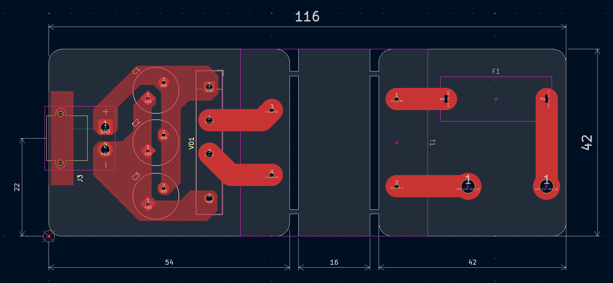
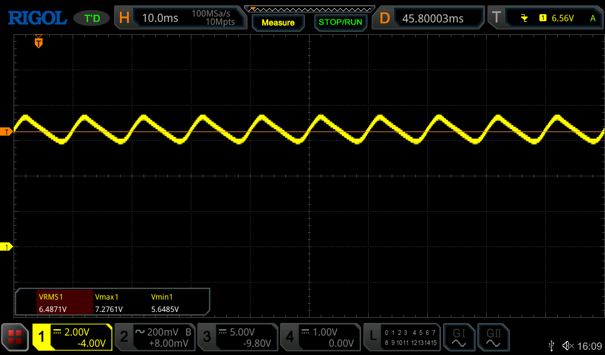

# Трансформаторный источник питания для стенда

Для обеспечения электробезопасности все электрические элементы стенда запитываются от изолированного трансформаторного БП. В этой папке проект печатной платы БП. Плата изготавливалась на станке ЧПУ, конфиг для `pcb2gcode` находится в папке `mill`.

Основа - трансформатор ТП-1201 с номинальным напряжением на вторичной обмотке 6В.

Схема в файле [stand-ps.pdf](stand-ps.pdf).

Форма выходного напряжения при нагрузке 1А:

