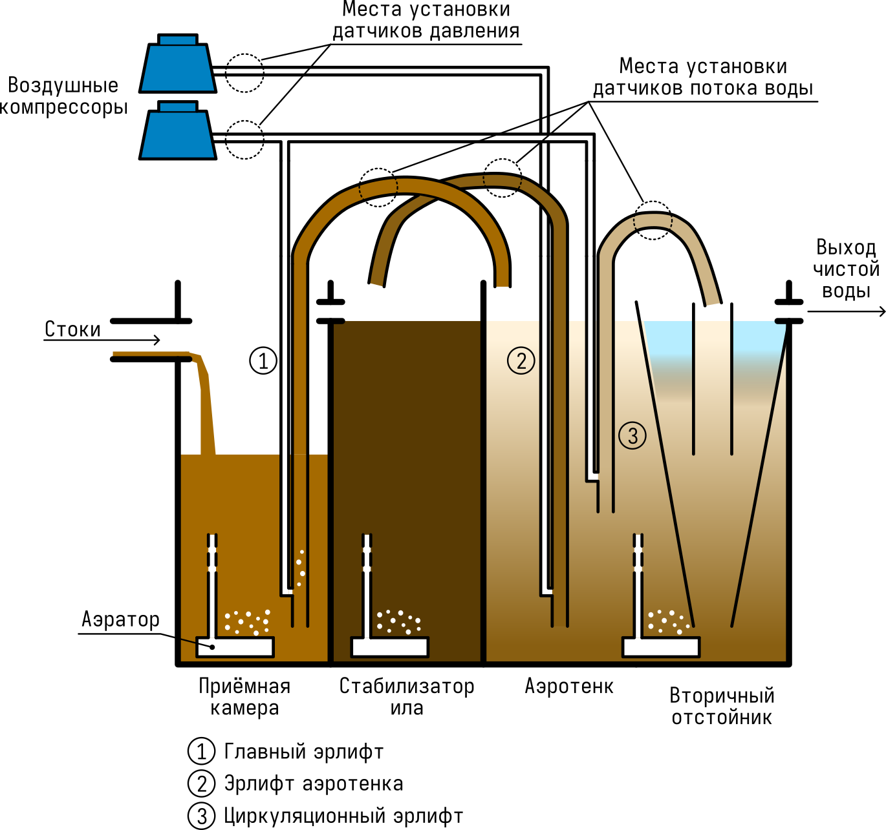
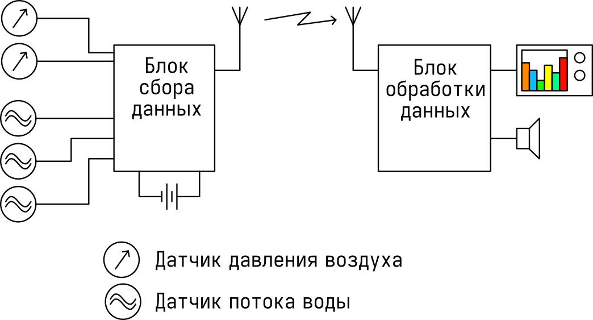

# Проект "Система мониторинга аэрационной станции очистки сточных вод"

Ментор: Азамат

Исполнитель: Пузанов Игорь

## Цель проекта

Разработать функциональный прототип системы мониторинга работы аэрационной станции биологической очистки сточных вод для загородного дома, позволяющий контролировать режимы работы станции (потоки воды в эрлифтах, давление в воздухных магистралях), передавать данные из станции в дом по радиоканалу, анализировать данные и заранее предупреждать пользователя о неполадках в работе станции.

## Описание функционала

Аэрационная ЛОС - это локальная станция биологической очистки бытовых сточных вод, применяемая в загородных домах. К таким установкам относятся станции типа Топас, Юнилос, Астра и аналогичные системы.

Внутри станции сточные воды проходят несколько этапов очистки: отстаивание, аэробное окисление активным илом и последующую доочистку. Перекачка воды между камерами выполняется эрлифтами - устройствами, которые поднимают жидкость за счёт воздуха, подаваемого в погружённую трубу. Также в камерах установлены аэраторы, поддерживающие среду для работы аэробных бактерий.

Качество очистки зависит от правильной работы эрлифтов, компрессоров и своевременного переключения режимов станции. Если в трубках или шлангах появляются отложения, поток воды может ослабнуть или полностью прекратиться. Это приводит к нарушению режима очистки, выносу ила, ухудшению качества воды на выходе, переполнению камер и риску повреждения электрического блока управления.

Штатные аварийные сигнализаторы обычно сообщают только о переполнении. Однако нарушения в работе станции часто начинаются значительно раньше. Предлагаемая система должна отслеживать эти признаки заранее.

Разрабатываемая система состоит из двух основных частей:

### Измерительный блок (блок сбора данных), размещённый внутри станции

Блок подключается к датчикам потока воды и датчикам давления воздуха, собирает показания и передаёт их по радиоканалу. Блок должен:

- иметь автономное питание, обеспечивающее время непрерывной работы до полугода (типичный интервал техобслуживания станции);
- находиться во влагозащищённом корпусе для защиты от повышенной влажности внутри станции;
- обеспечивать работу в диапазоне температур от -10 до +30 градусов Цельсия;

Периодичность опроса датчиков должна быть не менее 1 раза в секунду.

Датчики потока воды должны работать по бесконтактному принципу для исключения загрязнения и помех в работе эрлифтов.

Радиоканал должен обеспечивать устойчивую передачу данных на расстояние не менее 30 метров.

### Домашний блок приёма и анализа данных (блок обработки)

Блок принимает показания, анализирует данные, сохраняет историю работы станции, отображает состояние системы и предупреждает пользователя об отклонениях. Это может быть как автономное устройство с выходом в сеть и/или с дисплеем и органами управления, так и блок, подключаемый к персональному компьютеру.

## Существующие аналоги

Анализ не показал наличие полных аналогов предлагаемой системы. Частичные аналоги можно разбить на категории:

### Потребительские решения (Производители ЛОС)

Большинство популярных систем (Топас, Астра, Юнилос и др.) используют стандартный подход, в котором мониторинг ограничен "аварийным сигнализатором" (поплавковый датчик), который срабатывает только при переполнении приёмной камеры.

Сторонние организации предлагают модули, которые могут сообщать о переполнении, измерять мутность и температуру [1].

Некоторые производители бытовых станций (например, Юнилос) предлагают GSM-системы оповещения, которые отправляют SMS-сообщения владельцам, если они проживают в загородном доме не постоянно [2].

### Промышленные системы управления и мониторинга

Коммерческие решения ориентированы на крупные муниципальные объекты, промышленные предприятия или высокотехнологичные коммерческие системы очистки [3, 4]. Они характеризуются высокой степенью автоматизации и глубоким анализом параметров.

Эти системы технологически делают то же, что предлагаемая система, но в мастабах целых населённых пунктов, а не отдельных загородных домов.

### Любительские и DIY-решения

На форумах встречаются попытки автоматизировать септики. Наиболее популярны ультразвуковые датчики для контроля уровня воды и оповещения через посылку сообщений на телефон [5].

Встречаются системы контроля работы воздухных компрессоров с помощью датчиков напряжения [6] или тока [7].

Существует множество проектов по созданию систем мониторинга качества воды с использованием датчиков TDS (общее количество растворенных твердых веществ), pH, мутности и температуры [8, 9, 10,11], но обычно их применяют для оценки качества питьевой воды.

### Вывод

Проанализировав рынок, можно выделить ключевое отличие предлагаемой идеи от существующих аналогов:

1.  Профессиональные системы слишком дороги и избыточны для частного дома, так как нацелены на контроль сложных биохимических процессов и муниципальные стандарты.
2.  Любительские проекты, как и решения, предлагаемые производителями ЛОС в основном сосредоточены на "поверхностных" показателях: уровне воды, мутности или простом факте работы насоса через потребление тока. Они не пытаются анализировать внутреннюю механику работы ЛОС (поток в эрлифтах и динамику давления воздуха).

В отличие от любительских датчиков уровня, наша система позволяет обнаружить засор эрлифта или падение производительности компрессора на этапе, когда биохимические показатели (pH или мутность) еще не успели измениться, а до переполнения приёмной камеры ещё очень долго.

## Элементная база

### Датчики давления
В качестве датчиков давления можно применить недорогой MEMS-барометр. Например [MPS20N0040D](https://cdn.sparkfun.com/assets/home_page_posts/1/9/0/2/Pressure_Sensor.pdf), который обеспечивает измерение давления в диапазоне 0-40кПа (относительно атмосферного) и работает в широком диапазоне температур.

### Датчики потока воды в эрлифтах
В качестве датчика потока можно использовать готовые ёмкостные датчики, например [XKC-Y26](https://naylampmechatronics.com/img/cms/001339/XKC-Y26-V.pdf). Датчик имеет цифровой выход и позволяет определять наличие/отсутствие воды в трубе. Однако, он имеет ряд недостатков - отсутсвие герметичного корпуса, невозможность автоматической калибровки, невозможность оценки мгновенного количества воды в трубе.

В связи с этим рассматривается вариант самостоятельного изготовления датчика, лишенного перечисленных недостатков.

### Блок сбора информации
Блок сбора можно выполнить на основе простого малопотребляющего микроконтроллера (AVR, MSP430, ARM-Cortex-M) и радиомодуля LoRa.

### Блок обработки
Для блока обработки можно применить готовый модуль микрокомпьютера (например, Raspberry Pi или какой-то из отечественных аналогов) и радиомодуль LoRa для приёма телеметрии из станции. Такой блок можно подключить к домашней локальной сети и получать данные на компьютер или телефон через интернет.

# Ссылки

- [1] [https://los-servis.ru/81-wi-fi-gsm-datchiki-dlya-septika](https://los-servis.ru/81-wi-fi-gsm-datchiki-dlya-septika)
- [2] [https://sbm-group.ru/products/unilos-astra](https://sbm-group.ru/products/unilos-astra)
- [3] [https://www.smartsystechnology.com/smart-stp-systems/](https://www.smartsystechnology.com/smart-stp-systems/)
- [4] [https://www.hach.com/industries/wastewater](https://www.hach.com/industries/wastewater)
- [5] [https://www.hackster.io/yaranaiotguru/iot-based-smart-water-level-monitoring-system-using-esp32-de3de2](https://www.hackster.io/yaranaiotguru/iot-based-smart-water-level-monitoring-system-using-esp32-de3de2)
- [6] [https://hackaday.io/project/160407-diy-wastewater-treatment-controller](https://hackaday.io/project/160407-diy-wastewater-treatment-controller)
- [7] [https://github.com/tgolla/AerobicSepticSystemMonitor](https://github.com/tgolla/AerobicSepticSystemMonitor)
- [8] [https://forum.arduino.cc/t/expert-needed-im-building-a-water-quality-monitoring-system-using-esp32-and-power-bi/1285604](https://forum.arduino.cc/t/expert-needed-im-building-a-water-quality-monoring-system-using-esp32-and-power-bi/1285604)
- [9] [https://www.hackatronic.com/water-quality-monitoring-system-tds-sensor-esp32-arduino/](https://www.hackatronic.com/water-quality-monitoring-system-tds-sensor-esp32-arduino/)
- [10] [https://iotprojectsideas.com/iot-water-quality-monitoring-with-tds-sensor-esp32/](https://iotprojectsideas.com/iot-water-quality-monitoring-with-tds-sensor-esp32/)
- [11] [https://randomnerdtutorials.com/esp32-tds-water-quality-sensor/](https://randomnerdtutorials.com/esp32-tds-water-quality-sensor/)
